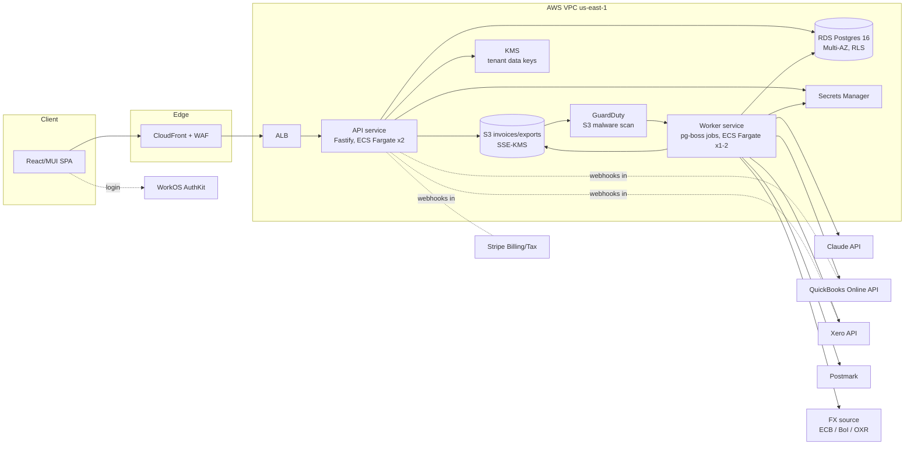

# 01 · Architecture

## 1. Variant A vs B, and the default

| | **A: build inside the existing product backend** | **B: greenfield service** |
|---|---|---|
| What | Add the Pilot features (invoice check, leaks, accounting sync, Maya live, studio) to the app.triplanet.io backend | A new backend that takes over the Live features (projects, quotes, catalog, clients, income/vouchers) as well as the Pilot ones |
| Time to a paying pilot | shorter **if** the codebase is sound: no rebuild of the 6 Live features | longer: rebuilds the Live features, about 35-45 engineer-days (see `10-roadmap.md` epic E-LIVE) [estimate] |
| Pen-test and compliance risk | inherits whatever the existing backend does on tenant isolation, money types, audit and secrets. Unknown: **the repository is not attached to this session**, and `list_repos` shows only `Triplanet-vibe-demo` and `Triplanet` (research) | designed for ASVS L2 from day 1 |
| Dependency on the current team | high | low. The owner can staff it independently |
| Frontend | the existing React/MUI app gets new screens | the existing React/MUI app is repointed to the new API if its code is usable; otherwise rebuilt in React/MUI using the demo as the spec |

**Recommended default: B, decided finally at the end of the 1-week code audit.** Switch to A only if the audit passes **all six gates** below.

The deciding argument is that the new value lives in finance. That feature set needs integer money, many-to-many invoice allocation, an audit trail on every money field and DB-enforced tenant isolation. Retrofitting those into a year-old schema typically costs as much as writing them fresh. It also carries the risk that the pen test finds the retrofit incomplete. [estimate — the audit tests this assumption]

Either way, the new modules are built as **portable packages** (finance engine, extraction pipeline, connectors, Maya tools). Most of the work therefore survives whichever variant wins.

**Audit gates for A** (each must pass):

1. **Tenant isolation** is enforced in one place (DB RLS, or a single mandatory ORM scope) and has tests. A raw-query search finds no unscoped tenant reads.
2. **Money** is stored as integer minor units or decimal, never float or `double`.
3. **Schema migrations** are version-controlled, reversible and run in CI.
4. **Tests:** pricing and quote totals have automated tests; CI is green on `main`.
5. **Security baseline:** a dependency scan and SAST (Semgrep/CodeQL) show no unresolved critical findings older than 30 days, and no secrets in git history (gitleaks).
6. **Delivery:** the 3-4 week trial sprint ships its scope on time to the acceptance criteria in `10-roadmap.md` (T-TRIAL-*).

Gates 1-5 are checked in the audit week; gate 6 is checked at the end of the trial.

**Variant A delta**, if the gates pass: drop epic E-LIVE (rebuilding the Live features) and E-FE-PORT (repointing the frontend). Keep everything else, but adapt epics E-FOUND (infra, auth, tenancy) to the existing stack. The audit report must list, per epic, what already exists. Saving: about 35-55 engineer-days [estimate].

## 2. Stack (variant B)

| Layer | Choice | Rejected and why |
|---|---|---|
| Language | **TypeScript** on Node.js 22 LTS, end to end | Python/Django: a fine choice, but the frontend is React/TypeScript and the finance engine must run in both browser and server. One language halves the context Claude Code needs per ticket |
| HTTP framework | **Fastify** + Zod + `fastify-type-provider-zod` (generates OpenAPI) | NestJS: heavier, decorator-driven, more magic for an auditor. Express: no schema-first validation |
| Database | **PostgreSQL 16** on AWS RDS, Multi-AZ | Aurora Serverless v2: $0.12/ACU-h and a 0.5 ACU floor [unverified - third-party sites]; no advantage at this size. DynamoDB: no RLS, no relational integrity for money |
| DB access | **Kysely** (typed SQL builder) + plain SQL migrations (`node-pg-migrate`) | Prisma: RLS needs `set_config` per transaction, which Prisma's connection handling makes awkward [unverified, commonly reported]. Drizzle: workable; Kysely keeps the SQL visible, which helps RLS review |
| Jobs and queue | **pg-boss** (Postgres-backed queue: retries, backoff, dead-letter, cron) | SQS + Lambda: more moving parts. BullMQ: needs Redis. One datastore is less to secure and back up. Revisit above about 50 jobs/s [estimate] |
| Files | **S3**: SSE-KMS, Block Public Access, presigned PUT/GET (5-minute expiry), GuardDuty Malware Protection for S3 ($0.09/GB scanned) [verified - aws.amazon.com/guardduty/pricing via the research file] | ClamAV sidecar: a fallback if GuardDuty is not available in il-central-1 |
| Auth | **WorkOS AuthKit**: free to 1M MAU; SSO/SAML $125 per connection per month when a customer asks [verified - workos.com/pricing via the research file] | Clerk: B2B add-on $100/mo plus $75 per SAML connection [unverified]. Auth0 B2B Essentials from $150/mo [verified]. Cognito: cheap, but weak B2B org and invitation features; more glue to own |
| Email | **Postmark** (transactional; inbound parsing on Pro, $16.50/mo) [verified - postmarkapp.com/pricing via the research file] | SES: cheapest at $0.10 per 1k, but more deliverability work; keep as a fallback |
| LLM | **Claude API** direct, server-side (see `05-ai.md`) | Bedrock: possible later for an AWS-only data path; the model and feature lag must be checked first |
| Compute | **ECS Fargate** (ARM), 2 tasks API + 1 worker, behind an ALB + AWS WAF | Render/Fly/Railway: cheaper to start (Fly Managed Postgres from $38/mo [verified]), but no Tel Aviv region, KMS field encryption or private networking, and a harder SOC 2 story. Kubernetes: overkill |
| IaC | **Terraform** (or OpenTofu), one module per environment | CDK: fine, but Terraform is what most pen-test and SOC 2 auditors read |
| Frontend | existing React/MUI app (if usable) or Vite + React + MUI v6 "Minimal"-compatible theme, generated API client | Next.js SSR: no SEO need; an SPA keeps the attack surface to the API |
| Observability | Sentry (errors), Better Stack (uptime, status page, logs at $0.10/GB) [verified - betterstack.com/pricing via the research file], CloudWatch (infra) | Datadog: $15-31 per host [unverified]; too much for year 1 |

## 3. Tenancy model (decision): shared schema + Postgres row-level security

| Model | Isolation | Ops cost | Verdict |
|---|---|---|---|
| **Shared tables + `tenant_id` + RLS (FORCE)** | DB-enforced on every query | one schema and one migration path | **chosen** |
| Schema per tenant | strong | migrations × N; connection-pool and search_path bugs; reporting across tenants (anonymised benchmarks) needs unions | rejected at 1-50 tenants; revisit only if a customer contractually demands it |
| Database per tenant | strongest | N databases to patch, back up and restore; expensive | offered only as an enterprise tier, out of scope |

Why RLS rather than application-level scoping alone:

- A forgotten `WHERE tenant_id` becomes an empty result, not a data leak (see `02-data-model.md` §4).
- It is testable mechanically: a CI check that every tenant table is `FORCE RLS` with a policy.
- Pen testers check IDOR across tenants first, and RLS is a second wall behind the API's authorization check.

**Residency.** Israeli tenants' data can live in a separate cluster in AWS il-central-1 (Tel Aviv): RDS, S3 and KMS in-region [availability per service to verify: see `08-compliance.md` §2]. The `tenant.data_region` field routes each request to the right cluster, using the same code and the same Terraform module with a different region. **Not in the MVP** unless an Israeli pilot needs it (`11-open-questions.md` Q2).

## 4. Components



**Request path:**

1. The SPA gets a JWT from AuthKit.
2. The API verifies the JWT, checks membership in the tenant in the path, opens a transaction and sets `app.tenant_id`, `app.user_id` and `app.role`.
3. Handler code runs.
4. On commit, the outbox rows are published to pg-boss.

**Job path:**

1. The worker picks a job and sets the tenant from the job payload. The payload is signed by the API, so a forged job cannot switch tenants.
2. The job runs.
3. The result is written back, with an audit row.
4. On failure: retry with exponential backoff, up to 5 attempts, then the dead-letter queue, then an alert.

**Egress control.** Workers reach the internet through a NAT gateway with an allow-list proxy (or AWS Network Firewall domain list) for the vendor hosts only:

- `api.anthropic.com`
- `quickbooks.api.intuit.com`
- `oauth.platform.intuit.com`
- `api.xero.com`
- `identity.xero.com`
- `api.stripe.com`
- `api.postmarkapp.com`
- the FX source

This is the SSRF control (see `07-security-pentest.md`).

## 5. Monorepo layout

```
triplanet-platform/
  apps/api/            Fastify app, routes, auth, RLS session
  apps/worker/         pg-boss workers
  apps/web/            SPA (or a submodule of the existing product frontend)
  packages/finance/    pure finance engine (04-finance-engine.md)
  packages/planner/    studio routing and day planning (from v6/s8_gen.js)
  packages/extract/    invoice extraction pipeline and evaluation harness (05-ai.md)
  packages/connectors/ qbo/, xero/, priority/, hash/  (06-integrations/)
  packages/maya/       tool definitions, grounding, guardrails
  packages/i18n/       EN/HE dictionary (from v6/s2_i18n.js)
  db/migrations/       SQL migrations
  infra/terraform/     envs/dev, staging, prod-us, prod-il
  docs/                ADRs, runbooks
```

Each package has its own tests and README, so a Claude Code session can own one package per ticket.

## 6. What carries over from the demo

| Demo asset | Carries over as |
|---|---|
| Screens (`v6/s4_views.js`, `s5_fin.js`, `s7_leak.js`, `s7b_product.js`, `s8_gen.js`) | UX spec and acceptance screenshots (`shot8.js` outputs) |
| Finance math (`s1_core.js` `calc`, `invStatus`, `gapStats`, `groupsCalc`; `s7_leak.js`) | `packages/finance`, rewritten in integer money; parity test T10 |
| `check6.js` identities | `packages/finance` property tests T1-T9 |
| i18n dictionary (`s2_i18n.js` DICT) | `packages/i18n`, keyed messages, not Hebrew-to-English string translation |
| FEAT table (`s9b_status.js`) | the scope list in `10-roadmap.md` |
| Catalog (`s1c_catalog.js`: 65 hotels, 82 venues, with `src` URLs) | the `ref_hotel`/`ref_venue` seed, with rates removed (they are illustrative) |
| Maya's scripted QS (28) | the evaluation prompts for Maya live (`05-ai.md` §3.5) |
| Dropped | meeting mode, scripted Maya answers, `brandSwap`, generated data, fixed today, `commPaid`, attract/kiosk mode, the browser-held API key |
