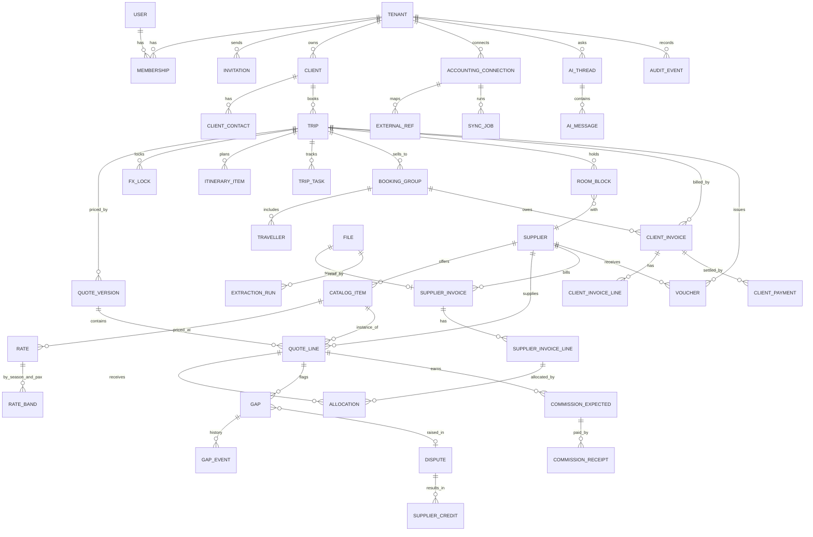

# 02 · Data model

This file defines Postgres 16 with row-level security (the tenancy model is in `01-architecture.md` §3). Money is `bigint` minor units plus a `char(3)` currency (`04-finance-engine.md` §2).

## 1. Conventions (apply to every table unless stated)

- **Keys.**
  - `id uuid primary key default uuidv7()` — time-ordered, not guessable. Postgres 18 has `uuidv7()` built in [unverified]; on 16, generate it in the app or use the `pg_uuidv7` extension.
  - Public IDs in URLs are the same UUIDs. Never sequential integers: those make IDOR probing trivial.
- **Tenant column.**
  - `tenant_id uuid not null references tenant(id)`.
  - An RLS policy: `using (tenant_id = current_setting('app.tenant_id')::uuid)`, with the same `with check`.
  - The column is part of every composite unique index and every foreign key that crosses tables: `(tenant_id, id)`. A row can then never reference another tenant's row, even through a bug.
- **Common columns.**
  - `created_at`, `created_by`, `updated_at`, `updated_by`.
  - `deleted_at timestamptz null` for soft delete.
  - `version int` for optimistic concurrency: updates send `If-Match`, see `03-api.md`.
- **Soft delete.** The RLS policy also filters `deleted_at is null` for normal roles. A purge job hard-deletes after the retention period (see `08-compliance.md` §5). Restore is available to owner and admin for 30 days.
- **Audit.** Covered tables write to `audit_event` through a trigger:
  - which tables: every table with a money, rate, quantity, stage or status column;
  - how the trigger works: it is `SECURITY DEFINER` and inserts into an append-only table that the app role cannot update or delete.

## 2. ERD



## 3. Tables

Types are abbreviated: `money` = `bigint` minor units with a sibling `*_cur char(3)`; `fk` = `uuid` with a composite `(tenant_id, x)` FK; ⊕ = audited.

### 3.1 Tenancy and identity

| Table | Key fields | Notes |
|---|---|---|
| `tenant` | `id, name, legal_name, country, reporting_cur, timezone, locale_default (en/he), data_region (us/il), plan, status (trial/active/suspended/terminated), terminated_at` | no RLS (global); readable only through `membership`. `data_region` picks the database cluster (see `09-ops.md` §2) |
| `user` | `id, idp_subject, email, name, locale, mfa_enrolled (mirror of the IdP)` | global. The identity provider (IdP) owns credentials and MFA; we store no passwords |
| `membership` ⊕ | `tenant_id, user_id, role (owner/admin/agent/accountant/viewer), agent_code, status` | the role is per tenant: one user can sit in two tenants, e.g. an external accountant |
| `invitation` | `tenant_id, email, role, token_hash, expires_at, accepted_at` | single-use token; only its hash is stored |
| `api_token` | `tenant_id, name, scopes[], token_hash, last_used_at, expires_at` | phase 2 (customer integrations) |

**Roles.** The demo has `manager` plus one role per agent, who sees only their own trips (`canSee`, `v6/s3_shell.js:16`). The production roles:

| Role | Scope |
|---|---|
| `owner` | everything, billing, deleting the tenant, data export |
| `admin` | everything except billing and tenant deletion |
| `agent` | trips where they are `owner_user_id` or a `collaborator`; read-only catalog; no accounting connection; no other agents' P&L. Matches the demo's agent view |
| `accountant` | read on all trips' finance; write on supplier invoices, gaps, credits, client invoices/payments and accounting sync; no quote pricing edits |
| `viewer` | read-only, everything except finance. For guides and ops staff later |

### 3.2 Clients, trips, quotes

| Table | Key fields | Notes |
|---|---|---|
| `client` ⊕ | `tenant_id, name, type (church/school/club/association/agency/other), segment, billing_address, tax_id, default_markups jsonb` | the demo's `ctype`/`seg` |
| `client_contact` | `client_id, name, email, phone, role` | personal data (see `08-compliance.md`) |
| `trip` ⊕ | `tenant_id, client_id, code (human no., unique per tenant), name, destination_key, segment, owner_user_id, pax_planned, depart_on, nights, stage (quotation/operation/finance/closed/lost), quote_status (draft/approval/sent/negotiating/won/lost), pricing_basis (cost_plus/margin), deposit_pct, deposit_due_on, balance_due_on, reporting_cur` | the demo's 'Quote/Operations/Finance/Closed' map to the product's Quotation/Operation/Finance stages plus closed |
| `trip_collaborator` | `trip_id, user_id` | for the agent scope |
| `quote_version` ⊕ | `trip_id, version_no, status (draft/sent/accepted/superseded), sent_at, accepted_at, accepted_by_contact, engine_version, totals jsonb (frozen at send)` | a sent quote is immutable; edits create a new version |
| `quote_line` ⊕ | `quote_version_id, line_no, service_type (Lodging/Transport/Guide/Activities/Meals/Insurance/Other), name, supplier_id, catalog_item_id, rate_id, qty numeric(12,3), unit, unit_cost money, cost_cur, scope (shared/per_person), markup_override_bp int, commission_bp int, comp_policy jsonb, is_extra bool` | basis points (bp) for percentages: integers, so no float. `is_extra` = created by the matcher for unplanned charges |
| `quote_discount` ⊕ | `quote_version_id, scope, service_type, mode (pct/amount), value` | `discOf` |
| `fx_lock` ⊕ | `trip_id, currency, rate numeric(18,8), source (ecb/oxr/manual), source_ts, locked_at, locked_by, reason` | unique on (trip, currency) |
| `itinerary_item` | `trip_id, day_no, sort, name, hours numeric(4,2), catalog_item_id, kind (visit/travel/meal/free)` | the day plan; the demo's drag-and-drop writes this |
| `trip_task` | `trip_id, title, due_on, assignee_user_id, done_at, template_key` | the demo's `TASKT` checklist |

### 3.3 Travellers (highest-sensitivity data)

| Table | Key fields | Notes |
|---|---|---|
| `booking_group` ⊕ | `trip_id, name, size, primary_contact jsonb (encrypted)` | the household that pays |
| `traveller` | `booking_group_id, given_name, family_name, dob (encrypted), passport_no (encrypted), passport_country, passport_expiry (encrypted), diet, medical_notes (encrypted), emergency_contact (encrypted), room_ref` | field-level encryption with the tenant's data key (see `07-security-pentest.md` §4). **MVP decision:** passport fields stay off until the pen test is closed; the demo shows "Received/Missing" only |

### 3.4 Suppliers, catalog, contracts

| Table | Key fields | Notes |
|---|---|---|
| `supplier` ⊕ | `tenant_id, name, kind (hotel/coach/guide/venue/restaurant/airline/insurer/dmc/other), country, currency_default, payment_terms_days, email_ap, tax_id, brand_ref` | `brand_ref` links to the global brand list (optional, display only) |
| `catalog_item` | `supplier_id, kind, name, city, geo point, capacity, meta jsonb` | hotels, venues, activities. The demo's 65 hotels and 82 venues become a **global reference catalog** (`ref_*` tables, no tenant) that tenants copy from |
| `rate` ⊕ | `catalog_item_id, name, unit, currency, commission_bp, comp_policy jsonb, valid_from, valid_to, contract_file_id` | a contracted rate |
| `rate_band` ⊕ | `rate_id, season_from, season_to, pax_min, pax_max, occupancy, unit_cost money` | seasons × pax bands; picking a band is deterministic, by date then pax, with no overlap (enforced by an exclusion constraint) |
| `room_block` ⊕ | `trip_id, supplier_id, rooms_held, rooms_picked_up, cutoff_on, attrition_pct_bp, release_schedule jsonb` | the demo's `t.room`; release exposure uses `cutoff_on` |

### 3.5 Supplier invoices and the gap workflow

| Table | Key fields | Notes |
|---|---|---|
| `file` | `tenant_id, kind (supplier_invoice/contract/attachment/export), storage_key, sha256, mime, size, scan_status (pending/clean/infected/error), uploaded_by, source (upload/email/accounting)` | the object lives in S3; the row is its metadata. `sha256` is unique per tenant, which detects duplicate files |
| `supplier_invoice` ⊕ | `tenant_id, supplier_id, trip_id null, file_id, number, issue_date, due_date, currency, total money, tax money, status (draft/needs_review/confirmed/posted/void), extraction_run_id, confirmed_by, confirmed_at, external_ref_id` | unique `(tenant_id, supplier_id, number)` excluding void rows — the first `dup` guard |
| `supplier_invoice_line` ⊕ | `supplier_invoice_id, line_no, description, qty, unit_price money, amount money, service_date, field_confidence jsonb` | |
| `allocation` ⊕ | `invoice_line_id, quote_line_id, qty, amount money, method (auto/manual), score` | many-to-many; see `04-finance-engine.md` §3.3 |
| `gap` ⊕ | `tenant_id, trip_id, quote_line_id, kind, status (open/disputed/credited/accepted), amount_reporting money, amount_orig money, detected_at, detected_by (matcher/user), engine_version` | one open gap per (quote_line, kind) |
| `gap_event` | `gap_id, from_status, to_status, actor, note, at` | append-only |
| `dispute` ⊕ | `tenant_id, supplier_id, status (draft/sent/answered/closed), sent_at, channel (email/manual), email_message_id, body_snapshot` | can group several gaps for one supplier; the demo's `disputeMail` |
| `supplier_credit` ⊕ | `dispute_id null, supplier_id, number, amount money, received_on, allocated_to quote_line_id, external_ref_id` | becomes a QBO VendorCredit or a Xero credit note |
| `commission_expected` ⊕ | `quote_line_id, amount money, due_on` | |
| `commission_receipt` ⊕ | `commission_expected_id, amount money, received_on, reference` | replaces the demo's `commPaid` |

### 3.6 Client billing

| Table | Key fields | Notes |
|---|---|---|
| `client_invoice` ⊕ | `tenant_id, trip_id, booking_group_id null, kind (deal_invoice/tax_invoice/tax_invoice_receipt/credit_note/receipt), number (per-tenant series), issue_date, due_date, currency, subtotal, tax, total, status, allocation_no (IL only), external_ref_id` | the product's Income screen. Number series are gap-free per kind, which Israeli bookkeeping rules require [unverified for the US; standard practice] |
| `client_invoice_line` | `client_invoice_id, description, qty, unit_price, amount, tax_code` | |
| `client_payment` ⊕ | `client_invoice_id, amount, method (ach/card/check/wire/cash), received_on, processor_ref, external_ref_id` | phase 1: recorded, or synced from accounting; Stripe Connect is phase 2 |
| `voucher` ⊕ | `trip_id, supplier_id, number, services jsonb, issued_at, file_id` | supplier service voucher (PDF) |

### 3.7 Integrations, AI and platform

| Table | Key fields | Notes |
|---|---|---|
| `accounting_connection` ⊕ | `tenant_id, system (qbo/xero/priority/hash_file), external_tenant_id (realmId/tenantId), status, token_ciphertext, token_key_id, token_expires_at, scopes, settings jsonb (class vs location, account map)` | the token is envelope-encrypted (see `07-security-pentest.md`) |
| `external_ref` | `connection_id, local_type, local_id, remote_type, remote_id, remote_sync_token, last_synced_at, hash` | idempotent upsert key: `(connection_id, local_type, local_id)` |
| `sync_job` | `connection_id, kind (push_bill/push_credit/pull_payments/cdc), status, attempts, last_error, payload_hash, started_at, finished_at` | its log is the demo's sync log |
| `extraction_run` | `file_id, model, prompt_version, status, input_tokens, output_tokens, cost_micros, result jsonb, field_confidence jsonb, latency_ms` | for the evaluation set and cost tracking |
| `ai_thread` / `ai_message` | `tenant_id, user_id, role, content, tool_calls jsonb, model, tokens, cost_micros, refusal bool, fallback_used bool` | retention 90 days by default (see `08-compliance.md`) |
| `ai_budget` | `tenant_id, month, cap_micros, spent_micros` | the per-tenant spending cap |
| `idempotency_key` | `tenant_id, key, request_hash, response jsonb, status, expires_at` | 24 h TTL (see `03-api.md`) |
| `webhook_inbox` | `source, event_id (unique), received_at, signature_ok, payload jsonb, processed_at` | dedupes provider webhooks |
| `audit_event` | `id bigserial, tenant_id, actor_user_id, actor_kind (user/system/integration/ai), action, entity, entity_id, before jsonb, after jsonb, ip, request_id, at, prev_hash, hash` | append-only, hash-chained per tenant; partitioned by month |
| `outbox` | `id, tenant_id, topic, payload, created_at, published_at` | transactional outbox feeding the jobs |

## 4. Row-level security pattern

```sql
-- role used by the API; it does NOT own the tables and does NOT have BYPASSRLS
create role app_user nologin;
alter table trip enable row level security;
alter table trip force row level security;   -- applies to the table owner too
create policy tenant_isolation on trip
  using (tenant_id = current_setting('app.tenant_id', true)::uuid and deleted_at is null)
  with check (tenant_id = current_setting('app.tenant_id', true)::uuid);

-- set per transaction by the API after it has authenticated the request
begin;
select set_config('app.tenant_id', $1, true);   -- true = local to this transaction
select set_config('app.user_id',   $2, true);
select set_config('app.role',      $3, true);
-- ... queries ...
commit;
```

- The agent scope ("own trips only") is a **second policy** on `trip` and its child tables. It uses `app.role` and `app.user_id`. A forgotten `WHERE` in application code therefore still cannot leak another agent's trip.
- `current_setting(..., true)` returns null when the setting is unset, and `tenant_id = null` is never true. A request that forgot to set the tenant sees **nothing**; it does not see everything.
- Jobs run under the same role and set the tenant per job. A separate `app_admin` role with `BYPASSRLS` exists only for migrations and the support console (break-glass, audited).
- CI test: for every table with a `tenant_id` column, assert that RLS is enabled, forced, and has a policy. Fail the build otherwise (see `07-security-pentest.md` T-ISO-1).

## 5. Data export and termination

- **Export** (owner only): an async job writes a ZIP with:
  - one CSV and one JSON per entity;
  - every stored file (invoices, contracts);
  - a `manifest.json` with the schema version.

  The link expires after 7 days. It is offered in-app at any time and automatically on termination.
- **Termination:**
  1. `status = terminated`;
  2. read-only for 30 days, export available;
  3. hard delete at day 30, plus 35 days for backups to roll off.

  The DPA states this (see `08-compliance.md`).
