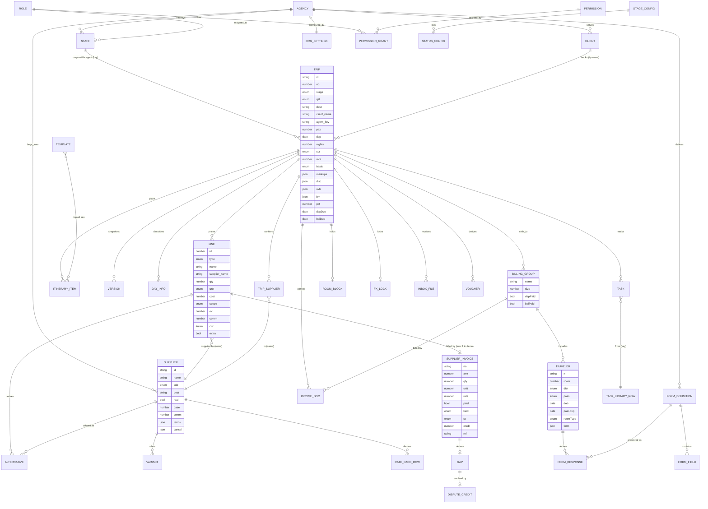

# Data model

What this is: every record the booth demo keeps, as the demo actually stores it, so the real product can model the same things. It is written from the code in `v6/*.js` (commit `c250ab3`). When this file and the code disagree, the code is right; tell us.

Read first: `README.md` in this folder. Rules (formulas, edge cases, tests) are in `business-rules.md`. Screens are in `screens.md` (generated).

## 0. How to read the tables

- **Storage in the demo.** Everything lives in memory and is saved to `localStorage` key `triplanet-booth-demo-v8` (`v6/s3_shell.js: save`). Trips are plain objects in the array `TRIPS`. There is no database and no ids from a server.
- **Types.** `string`; `number` (money is a JS float in major units, rounded to 2 dp by `r2` after every step, `v6/s1_core.js: r2`); `date` (ISO `YYYY-MM-DD` string, `v6/s1_core.js: D, iso, addDays`); `bool`; `enum(a|b)`; `T[]`; `{…}` object. Percentages are plain numbers (`25` means 25%), never fractions.
- **Origin column.**
  - **R** = a real product concept. The shape should survive into production; the values here are samples.
  - **D** = demo-only. Generated by a seeded random generator or fictional (the agency, people, most suppliers, rates). Do not port the values, and do not port the generator.
  - **C** = computed from other fields. Production should compute it on read (or snapshot it with the engine version), not store it as a source of truth.
- **"Where".** `file: function` for where it is written (set) and read (get). `v6/` is omitted.
- **The demo's "today"** is the constant `TODAY = 2026-10-20` (`s1_core.js: TODAY`). Every dated rule uses it. Production passes an `asOf` date instead (`docs/backend-plan/04-finance-engine.md` §1).
- **Real-brand rule.** Hotel and venue names in `CATALOG` are real companies; rates and costs are illustrative. A real name is never placed next to a gap (`s8_gen.js: brandSwap`, `check6.js:50`). In production this rule disappears because the data is the customer's own (`04-finance-engine.md` §4).

## 1. Mapping to the backend plan

The backend plan is on branch `origin/claude/fervent-babbage-bkgptx`, `docs/backend-plan/02-data-model.md` and `04-finance-engine.md`. Names below follow it where a table exists. Differences are listed so nobody is surprised.

| Demo entity | Backend table (`02-data-model.md`) | Difference to know about |
|---|---|---|
| Agency (const `AGENCY`) | `tenant` | The demo has exactly one agency and no `tenant_id`. Org settings live in `ST_ORG` (§22). |
| Staff | `user` + `membership` | Demo staff is one list; role is a string on the row. The backend splits identity from per-tenant role. |
| Role | `membership.role` (owner/admin/agent/accountant/viewer) | Demo has `owner, admin, agent, accountant` only; no `viewer`. Staff row `Ops desk` has role `ops`, which is not in `ROLES` (it cannot log in; `s1e_people.js: roleOf` maps unknown roles to `agent`). |
| Permission | none yet | The backend plan has no permission table. Add one (§4). Demo: 40 keys, 8 claimed as enforced, actually 11 (see `business-rules.md` §25). |
| Client | `client`, `client_contact` | Demo joins trip to client by **name string** (`Trip.client` equals `Client.name`), not by id. Contact is one embedded object, not a table. |
| Trip | `trip` | Demo `stage` has 4 values (`Quote, Operations, Finance, Closed`); backend has `quotation/operation/finance/closed/lost`. Demo has no `lost` or `won`; winning a quote sets `stage='Operations'`. |
| Line | `quote_line` | Demo has one set of lines per trip, no `quote_version` parent. Versions are snapshots (§16). `scope` is `'shared'` or `'per person'` (with a space); backend uses `shared/per_person`. |
| Invoice | `supplier_invoice` + `supplier_invoice_line` + `allocation` | Demo: at most **one** invoice per line, embedded in `line.inv`, one amount. Backend is many-to-many through `allocation` (`04` §3.3). |
| Gap | `gap` + `gap_event` | Demo derives gaps from `line.inv` on every read; status lives on the invoice (`inv.st`). Backend stores them with history. |
| Dispute / Credit | `dispute`, `supplier_credit` | Demo has no dispute entity: "Mark as sent" only sets `inv.st='disputed'`; "Credit received" sets `inv.credit` and `inv.st='credited'`. The email text is generated, never stored. |
| Group | `booking_group` | Same idea. Demo stores two booleans (`depPaid`, `balPaid`); backend stores payments against invoices. |
| Traveler | `traveller` | Spelling differs (demo `trav`, UI "traveler"). Demo masks passport numbers (`•••• 1234`) and keeps dates as plain strings; backend encrypts them. |
| Task | `trip_task` | Demo has a 48-task library plus 12 older tasks (§13). |
| Supplier | `supplier` + `catalog_item` | Demo supplier mixes both: one row per supplier with `base` rate and variants. |
| RateCard row | `rate` + `rate_band` | Demo rate card is **derived** (`s1d_data.js: rateCard`) from `base`, season, pax band and variant; it is not stored. |
| Variant | `rate.name` / `catalog_item` | Demo variant is a multiplier on `base` (e.g. quad room = 1.22). |
| Alternative | none | Derived by `altsFor`; no table. |
| Block | `room_block` | Demo stores `{hotel, held, used}`; cutoff is always `dep − 30 days` (`s1e_people.js: blockOf`). Backend has `cutoff_on`, attrition and a release schedule. |
| Version | `quote_version` | Demo version is a light snapshot (§16). Backend versions are the primary parent of lines. |
| DayInfo | `itinerary_item` (partly) | Demo `dayInfo[d] = {desc, img}`; items are `t.items`. |
| IncomeDoc | `client_invoice` | Demo derives it (`s7b_product.js: incomeDocs`); nothing stored. Document numbers come from the trip number. |
| Voucher | `voucher` | Demo derives it: a layout in the Vouchers tab, number `V-<trip no>-<line id>`; nothing stored. |
| FX | `fx_lock` | Demo: one `rate` per trip for **all** non-USD lines. Backend: one lock per (trip, currency). Demo allows editing the rate at any stage by anyone who can open Pricing. |
| Form / field / response | none yet | Demo forms are schema-driven (§19). Responses are **derived** from traveler data (§20), not stored. |

## 2. Tenant / Agency

The demo has no tenant record. These constants stand in for it.

| Field | Type | Meaning | Example | Where | Origin |
|---|---|---|---|---|---|
| `AGENCY` | string | Agency name, used in documents and the sidebar | `Redbud Group Tours` | `s1_core.js: AGENCY`; read in `s3_shell.js: render`, `s4_views.js: pQuote` | D |
| `AGENCY_CITY` | string | Home city | `Tulsa, Oklahoma` | `s1_core.js` | D |
| `AGENCY_MAIL` | string | Inbox where supplier invoices arrive | `invoices@redbudtours.example` | `s1_core.js`; shown in `s5_fin.js: pTripFin` | D |
| `ST_ORG` | object | Org settings, see §22 | | `s10_settings.js` | R |

Production: `tenant` row with `name, country, reporting_cur, timezone, locale_default` (`02-data-model.md` §3.1). The home city in the demo is also hard-coded as the origin for drive times and flights ("Tulsa" in `s1_core.js: genLines`, `s8_gen.js: driveH`). Make it a tenant setting.

## 3. Staff / user

`STAFF` array, generated by `s1e_people.js: genStaff`. Edits persist through `PERSIST` key `pe-staff`.

| Field | Type | Meaning | Example | Where | Origin |
|---|---|---|---|---|---|
| `key` | string | Identity and the value of `S.role` when "viewing as" this person. `manager`, `accountant`, an agent first name, or `Ops desk` | `Priya` | set `genStaff`; read everywhere as `S.role`, `Trip.agent` | D |
| `en`, `he` | string | Display name in each language | `Priya Shah` / `פריה שאה` | `genStaff`; `s1_core.js: agn` | D |
| `role` | enum(owner\|accountant\|agent\|ops) | Role. `ops` is the shared Ops desk, not a login | `agent` | `genStaff`; `s1e_people.js: roleOf` | R |
| `email` | string | Work email, domain is a placeholder | `priya.shah@redbudtours.example` | `genStaff`; form `user` in `s10_forms.js` | D |
| `phone` | string | | `918-555-0110` | same | D |
| `target` | number \| null | Annual revenue target in USD. Agents only. Illustrative; the owner confirms | `380000` | `s1e_people.js: STAFF_TARGET`; read by `s10_dash.js: dbTeam` | D |
| `active` | bool | Inactive staff stay on past trips | `true` | form `user`; test `people persist` | R |

Staff list (default): `manager` (Ella Brooks, owner), `accountant` (Nora Kim), six agents (Priya Shah 380,000; Dana Whitfield 300,000; Marcus Reed 360,000; Grace Okafor 340,000; Luis Ortega 280,000; Tom Becker 260,000), `Ops desk`.

Two staff lookups exist in parallel and must not be confused: `AGENTS`, `AGE`, `AGN` in `s1_core.js` (name tables used by labels) and `STAFF`, `STAFF_BY` in `s1e_people.js` (editable records). `Trip.agent` stores the agent **key**. Production: one `user` + `membership`, and `Trip.owner_user_id`.

Roles the demo can "view as" (`s3_shell.js: ROLE_KEYS`): `manager`, `accountant`, and the six agents. `seesAll()` is true for owner and accountant; agents see only trips where `Trip.agent === S.role` (`s3_shell.js: canSee`, `visibleTrips`).

## 4. Role and Permission

`ROLES` (`s1e_people.js`): `owner, admin, agent, accountant`, each with `en` and `he`. There is no staff row with role `admin`; the role exists so the matrix has a column.

`PERMS` has **40** keys in **9** groups (`s1e_people.js: PERM_GROUPS, PERM_ROWS, PERMS`). The owner column is always `true` and is locked in the UI. Defaults for the other three roles are below. An override table `S.perms = {role: {permKey: bool}}` is edited in Settings and persisted (`s10_settings.js: stSetPerm`, `PERSIST st-perms`). `can(k)` reads the override first, then the default (`s1e_people.js: can`).

Field list of a permission: `k` (string key), `group`, `en`, `he`, and one boolean per role (`owner, admin, agent, accountant`). Origin R for the keys and defaults (the matrix is a design proposal the owner should confirm), D for nothing.

| Key | Group | Meaning | Agent | Accountant | Admin |
|---|---|---|---|---|---|
| `proj.viewAll` | Projects | See all projects | no | yes | yes |
| `proj.create` | Projects | Create projects and quotes | yes | no | yes |
| `proj.edit` | Projects | Edit project details | yes | no | yes |
| `proj.delete` | Projects | Delete projects | no | no | yes |
| `proj.assign` | Projects | Reassign the responsible agent | no | no | yes |
| `price.edit` | Pricing | Edit prices and markups | yes | no | yes |
| `price.seeCost` | Pricing | See supplier costs | yes | yes | yes |
| `price.overrideMarkup` | Pricing | Override the default markup | no | no | yes |
| `price.discount` | Pricing | Give client discounts | yes | no | yes |
| `price.templates` | Pricing | Manage pricing templates | no | no | yes |
| `prop.send` | Proposals | Send proposals to clients | yes | no | yes |
| `prop.approve` | Proposals | Approve proposals before sending | no | no | yes |
| `prop.formats` | Proposals | Choose proposal formats | yes | no | yes |
| `prop.public` | Proposals | Publish a public proposal link | yes | no | yes |
| `ops.tasks` | Operations | Manage operations tasks | yes | no | yes |
| `ops.manifest` | Operations | Edit the master list of travelers | yes | no | yes |
| `ops.suppliers` | Operations | Manage trip suppliers and confirmations | yes | no | yes |
| `ops.blocks` | Operations | Manage room blocks | yes | no | yes |
| `ops.messages` | Operations | Send traveler messages | yes | no | yes |
| `fin.view` | Finance | See finance pages | yes | yes | yes |
| `fin.issueDocs` | Finance | Issue invoices and receipts | no | yes | yes |
| `fin.recordPayment` | Finance | Record payments | no | yes | yes |
| `fin.approveBills` | Finance | Approve supplier bills | no | yes | yes |
| `fin.dispute` | Finance | Dispute supplier invoices | no | yes | yes |
| `fin.sync` | Finance | Run accounting sync | no | yes | yes |
| `fin.export` | Finance | Export finance data | no | yes | yes |
| `sup.edit` | Suppliers & catalog | Edit suppliers | yes | yes | yes |
| `sup.rates` | Suppliers & catalog | Edit supplier rate cards | no | no | yes |
| `sup.swap` | Suppliers & catalog | Swap a supplier on a trip line | yes | no | yes |
| `cat.edit` | Suppliers & catalog | Edit the hotel and venue catalog | no | no | yes |
| `cli.view` | Clients | See clients | yes | yes | yes |
| `cli.edit` | Clients | Edit clients | yes | yes | yes |
| `cli.export` | Clients | Export client lists | no | yes | yes |
| `users.manage` | Users & settings | Manage users | no | no | yes |
| `users.roles` | Users & settings | Edit roles and permissions | no | no | **no** |
| `settings.edit` | Users & settings | Edit agency settings | no | no | yes |
| `settings.stages` | Users & settings | Customize project stages | no | no | yes |
| `forms.build` | Users & settings | Build traveler forms | yes | no | yes |
| `ai.maya` | AI | Use Maya, the AI assistant | yes | yes | yes |
| `ai.live` | AI | Use live AI answers | yes | yes | yes |

Notes: `users.roles` is denied even for admin (owner only). The mismatch between "8 enforced" and what the code really enforces is in `business-rules.md` §25, §32.1.

## 5. Client

`CLIENTS` array, generated by `s1e_people.js: genClients`, persisted as `pe-clients`. 24 rows: 14 are the clients of the 20 demo trips, 10 are prospects (3 with an open lead).

| Field | Type | Meaning | Example | Where | Origin |
|---|---|---|---|---|---|
| `id` | string | `cl01`… | `cl01` | `genClients`, `cliAdd` | D |
| `name` | string | Organization name. **The join key to trips** | `Grace Fellowship Church` | `Trip.client` equals this; `cliByName` | R |
| `type` | enum(Church\|School\|Club\|Association\|Choir\|Agency\|Prospect) | Client type. `Prospect` = no trips yet | `Church` | `genClients`; labels `s1b_labels.js: CTE` | R |
| `kind` | enum | The type the client would have if it were not a prospect | `Church` | `genClients` | D |
| `city`, `state` | string | | `Stillwater`, `OK` | `genClients` | D |
| `contact` | `{name, role, email, phone}` | Main contact | `Margaret Hollis`, `Church administrator` | `genClients`; shown by `s10_sup.js: spCliHtml` | D |
| `since` | number | Year first booked | `2023` | `genClients` | D |
| `taxExempt` | bool | Sales-tax exempt. Stored and shown; **no money rule uses it** | `true` | `genClients` | R |
| `source` | enum(Referral\|Website\|Trade show\|Repeat) | Where the client came from | `Repeat` | `genClients` | R |
| `notes` | `{en, he}` | Free text | | `genClients` | D |
| `lead` | `{open, en, he}` | Prospects only: an open lead | `{open:true, en:'Open lead: …'}` | `genClients` | D |

Derived: a client's finance tab (`s10_sup.js: spCliFin`) sums, over the client's non-Quote trips, deal invoices `billed`, receipts `received`, `open = billed − received` and `booked = Σ calc(t).rev`.

## 6. Trip (project)

`TRIPS` array. Built by `s1_core.js: buildTrip` from `TRIP_SPECS` (20 trips), by `s6_rest.js: blankQuote` (new quote), `s8_gen.js: genCreate` (from the studio) and `s6_rest.js: dup` (copy of a past trip). Extra per-trip data is added by `TRIP_INIT` initializers (`s1_core.js: TRIP_INIT`, run in `s9_boot.js: runTripInit`).

| Field | Type | Meaning | Example | Where | Origin |
|---|---|---|---|---|---|
| `id` | string | Short id | `nen` | `TRIP_SPECS`, `blankQuote` (`n<nid>`) | D |
| `no` | number | Human number shown as `#3187` | `3187` | `buildTrip`, `blankQuote` | R |
| `name` | string | Trip name | `New England Fall Foliage` | form, `s6_rest.js` `data-ch="name"` | R |
| `dest` | enum(16 keys) | Destination key into `DESTS` (`HolyLand, Rome, Greece, Ireland, London, Niagara, Branson, Nashville, Washington, Canyon, NewEngland, NewYork, Smokies, SanAntonio, Chicago, NewOrleans`) | `NewEngland` | `s1_core.js: Dst`, `s1c_catalog.js` | R |
| `client` | string | Client **name** (see §5) | `Arrowhead Bank Prime Club` | `TRIP_SPECS` | R |
| `ctype` | enum | Copy of the client type | `Club` | `TRIP_SPECS`; test `people data` checks it equals the client's | D (duplicate; drop it) |
| `seg` | enum(Faith\|Student\|Senior\|Choir\|Alumni) | Group segment. Drives default markups, room occupancy and which attractions are included | `Senior` | `s1_core.js: SEG`, `genLines` | R |
| `agent` | string | Staff key of the responsible agent | `Dana` | `TRIP_SPECS`; `canSee` | R |
| `pax` | number | Paying travelers planned | `42` | `TRIP_SPECS` | R |
| `dep` | date | Departure date | `2026-10-06` | `TRIP_SPECS`; `blankQuote` = today + 210 d | R |
| `nights` | number | Number of nights. Days = nights + 1 | `6` | `TRIP_SPECS` | R |
| `stage` | enum(Quote\|Operations\|Finance\|Closed) | Lifecycle stage. See §6.1 | `Finance` | `TRIP_SPECS`; `s6_rest.js: winQuote` is the only code that changes it | R |
| `qst` | enum(Draft\|Approval\|Sent\|Negotiating) \| `''` | Quote status; empty after the quote is won | `Sent` | `s6_rest.js` `data-act="qs"`; `s10_prop.js: prAccept` | R |
| `qdays` | number | Days in the current quote status | `9` | `buildTrip`; reset to 0 on status change | D (should be computed from a timestamp) |
| `cur` | enum(USD\|EUR\|GBP\|CAD) | Destination currency of the trip | `EUR` | `buildTrip` from `DESTS[dest].cur` | R |
| `rate` | number | **Locked FX rate**, USD per 1 unit of `cur`. `1` when `cur=USD` | `1.08` | `buildTrip`; editable in `s4_views.js: pCosts` (`data-ch="rate"`, range 0.5 to 2) | R |
| `basis` | enum(cost\|price) | Markup basis: on cost, or of price | `cost` | `data-act="basis"` | R |
| `markups` | `{Lodging, Transport, Guide, Activities, Meals, Insurance: number}` | Markup % per service type; default from `SEG[seg].mk` | `{Lodging:25,…}` | `buildTrip`; `data-ch="mk"` clamps 0 to 90 | R |
| `disc` | `{ "s\|Type" or "p\|Type": {m:'%'\|'$', v} }` | Discount per scope and service type. `s` = shared, `p` = per person | `{"s\|Lodging":{m:'%',v:5}}` | `data-ch="dm"`, `"dv"`; `s1_core.js: discOf` | R |
| `ovh` | `{m:'%'\|'$', v, on:'both'\|'shared'\|'pp'}` \| absent | Overhead added to price | `{m:'%',v:5,on:'both'}` | `s10_prop.js: prSetFee` | R |
| `brk` | same | Brokerage fee, added to price **and** cost | `{m:'$',v:10,on:'pp'}` | `prSetFee` | R |
| `pct` | number | Deposit percent of the trip price | `25` | `data-ch="pct"` clamps 0 to 100 | R |
| `depDue` | date | Deposit due date, default `dep − 150 d` | `2026-05-01` | `buildTrip`, `blankQuote` (today + 60 d) | R |
| `balDue` | date | Balance due date, default `dep − 60 d` | `2026-08-07` | same (blank: today + 150 d) | R |
| `lines` | Line[] | Cost lines, §7 | | `genLines`, `genCreate` | R |
| `items` | Item[] | Itinerary items, §6.2 | | `genItems`, `s6b_dnd.js: dndMoveItem` | R |
| `groups` | Group[] | Billing groups, §11. Empty while `stage=Quote` | | `genGroups`, `winQuote` | R |
| `trav` | Traveler[] | Travelers, §12. Empty while `stage=Quote` | | `genTravelers`, `s1e_people.js: tripExtras` | R |
| `tasks` | Task[] | Tasks, §13 | | `genTasks`, `s10_ops.js: opInit` | R |
| `sups` | TripSupplier[] | Per-trip supplier status list, §6.3 | | `genSups`, `s10_sup.js` | R |
| `room` | `{hotel, held, used}` | Room block, §15 | `{hotel:'Maple Ridge Inn',held:24,used:22}` | `buildTrip`, `winQuote` | R |
| `inbox` | InboxFile[] | Supplier invoice PDFs waiting to be read, §8.1. Only the flagship trip `nen` has any | | `buildTrip`; `s1_core.js: applyInbox` | D |
| `versions` | Version[] | Saved quote versions, §16 | | `s10_tbcomp.js: tbVerSave` | R |
| `dayInfo` | `{[day]: {desc?, img?}}` | Per-day text and photo, §17 | | `s10_tbday.js: tbdInfo` | R |
| `mcols` | `{k, label}[]` | Custom master-list columns, max 6 | | `s10_ops.js: opAddCol` | R |

### 6.1 Stages and statuses

Two levels, kept separate in the demo:

| `stage` | `qst` values | Shown as | Stage switch (UI) | Set by |
|---|---|---|---|---|
| `Quote` | `Draft` In progress, `Approval` Manager approval, `Sent` Sent to client, `Negotiating` Awaiting close | "Quotation" | Quotation | generator, `qs`, `prAccept` |
| `Operations` | `''` | "Operation", status "Ready" | Operation | `winQuote` only |
| `Finance` | `''` | "Finance", status "In close" | Finance | generator only (no code path moves a trip here) |
| `Closed` | `''` | "Finance", status "Closed" | Finance | generator only |

The three-tab stage switch (`s7b_product.js: STAGES`: Quotation, Operation, Finance) is a **view** grouping tabs; it is not the same thing as `Trip.stage`. Operations, Finance and Closed trips all show the Operation and Finance tabs. Quote trips show those tabs behind a gate (`s3_shell.js: gate`).

Allowed quote moves in the demo: `Draft → Approval` (any user, `qs`), `Approval → Sent` (manager only; this is a UI check in `s4_views.js: pApprove`, the `qs` handler itself does not check), `Sent → Negotiating` ("Client asked to close", or `prAccept`), and from `Sent` or `Negotiating`: win (`winQuote`) which sets `stage='Operations'` and creates groups, tasks, supplier list, travelers and a room block. `prAccept` never skips `Approval` (test `prop formats and extras`).

Missing in the demo and needed in production: `lost`, moving Operations to Finance and Finance to Closed, re-opening, and an audit trail. The stage and status **configuration** (§23) is a preview only and does not drive trips.

### 6.2 Itinerary item (`Trip.items[]`)

| Field | Type | Meaning | Example | Where | Origin |
|---|---|---|---|---|---|
| `id` | number | Unique within the trip | `12` | `genItems`, `dndAddTpl` | R |
| `name` | string | Site or activity | `Western Wall` | `genItems`, `HL_ITEMS` | R |
| `hrs` | number | Hours the item takes | `1` | same | R |
| `day` | number | Day number, 1 to nights+1; `0` = optional/unscheduled | `3` | `data-ch="mv"`, `s6b_dnd.js: dndMoveItem` | R |

A day is "overloaded" when its hours exceed 9 (`s4_views.js: pPlan`, `s9d_maya.js: mayaPlanFix`).

### 6.3 Trip supplier (`Trip.sups[]`)

The confirmation status of each supplier on the trip, one row per supplier in use.

| Field | Type | Meaning | Example | Where | Origin |
|---|---|---|---|---|---|
| `n` | string | Supplier name (matches `Line.sup`) | `Maple Ridge Inn` | `genSups`; `s10_tbcomp.js: tbcSupSync` keeps it in step with swaps | R |
| `cat` | enum(service type) | Category | `Lodging` | `genSups` | R |
| `line` | number | Id of the line that supplier serves | `1` | `genSups` | R |
| `st` | enum(Not sent\|Sent\|No reply\|Confirmed) | Confirmation status | `Confirmed` | `data-act="cyc"`; `s10_sup.js: spSetFlow` | R |
| `flow` | enum(contact\|pending\|approved\|compare) | Position in the Contact / Pending / Approved / Price comparison board | `contact` | `s10_sup.js: spInit, spSetFlow` | R |
| `reqs` | `{[supplierId]: date}` | Alternatives asked for a quote, reply by today + 3 d | | `spRequest` | D (simulated) |

## 7. Line (cost line)

`Trip.lines[]`. The unit of pricing. Created by `s1_core.js: genLines` (generated), `addExtra` (unplanned charge), the studio, or `addsite` in `s6_rest.js`.

| Field | Type | Meaning | Example | Where | Origin |
|---|---|---|---|---|---|
| `id` | number | Unique within the trip | `1` | `genLines` | R |
| `type` | enum(Lodging\|Transport\|Guide\|Activities\|Meals\|Insurance) | Service type; markup and discounts are per type | `Lodging` | `TYPES` | R |
| `name` | string | Description | `Twin rooms, 6 nights` | `genLines` | R |
| `sup` | string | Supplier **name** (not an id) | `Maple Ridge Inn` | `genLines`; `tbSwap` | R |
| `qty` | number | Quantity in `unit` | `132` | `genLines` | R |
| `unit` | enum(room-night\|day\|transfer\|person\|meal\|evening\|'') | Unit of `qty` and `cost` | `room-night` | `genLines` | R |
| `cost` | number | Unit cost in the **line's currency** (`cur`), whole units | `229` | `genLines`; `data-ch="cost"` | R |
| `scope` | enum(shared\|per person) | `shared` = cost of the trip (rooms, coach, guide); `per person` = per traveler. Decides the discount key `s\|` or `p\|` | `shared` | `genLines` | R |
| `ov` | number \| `''` | Markup override % for this line; `''` = use the trip markup for the type | `30` | `data-ch="ov"` clamps 0 to 90 | R |
| `comm` | number | Supplier commission % on planned cost, counted as income | `15` | `genLines`; `tbSwap` copies it from the alternative | R |
| `cur` | enum(USD\|EUR\|GBP\|CAD) | Line currency. Air and insurance are always `USD` | `USD` | `genLines` | R |
| `inv` | Invoice \| null | The supplier invoice matched to the line, §8 | | `genInvoices`, `applyInboxFile` | R |
| `extra` | bool | `true` for an unplanned charge (fuel, overtime, duplicate). Such a line has `qty 0`, `cost 0` and an invoice | `true` | `s1_core.js: addExtra` | R |
| `alt0` | `{sup, cost, comm}` | The original supplier before a swap, kept so Undo restores it exactly | | `s10_tbcomp.js: tbSwap` | R |

Derived per line (`s1_core.js: calc`, `calc(t).lines[]`): `planUSD`, `price`, `fc`, `comm`, `amtDiff`, `fx`.

## 8. Supplier invoice (`Line.inv`)

| Field | Type | Meaning | Example | Where | Origin |
|---|---|---|---|---|---|
| `no` | string | Supplier's invoice number | `INV-20931` | `mkInv`, `NEN_INBOX` | R |
| `amt` | number | Amount billed, in the line's currency | `31602` | `mkInv` (`qty × unit`) | R |
| `qty` | number | Quantity billed | `138` | `mkInv` | R |
| `unit` | number | Unit price billed | `229` | `mkInv` | R |
| `rate` | number | Rate at which the bill was **paid** (for FX). `1` for USD lines | `1.1` | `mkInv` (locked rate + noise) | D (random); R as a concept |
| `paid` | bool | Paid by the agency | `true` | `genInvoices`; `settle` | R |
| `kind` | enum(qty\|rate\|comp\|extra\|dup\|under\|'') | Gap kind. `''` = a matching invoice | `qty` | `genInvoices` (random), `NEN_INBOX` (set by hand) | D (production derives it, `04` §3.3) |
| `st` | enum(open\|disputed\|accepted\|credited\|'') | Gap status | `open` | `genInvoices`; `data-act="gapsent"`, `gapacc`, `gapcred` | R |
| `credit` | number | Supplier credit received, same currency | `1374` | `settle`; `data-act="gapcred"` | R |
| `ref` | string | For a duplicate: the original invoice number | `INV-0412` | `addExtra` | R |

Effective amount: `effAmt(inv) = amt − credit` (`s1_core.js: effAmt`).

### 8.1 Inbox file (`Trip.inbox[]`, demo-only)

`{file, inv: [[lineId, {no, qty?, unit?, kind?}]], extra: [[lineId, name, amt, kind, ref]]}`. A "PDF" waiting to be read. `applyInboxFile` turns it into invoices and extra lines. Production replaces this with email ingestion and extraction (`docs/backend-plan/05-ai.md`). Origin D.

## 9. Gap (derived)

A gap is never stored. `s1_core.js: invStatus(l)` returns `{k, diff, kind, st, credit}` for every line:

| `k` | When |
|---|---|
| `none` | `inv` is null. Kind label `missing` |
| `match` | `abs(effAmt − planC) < 0.005` and no credit |
| `credited` | same, but `credit > 0` |
| `gap` | otherwise. `diff = effAmt − planC` |

Kinds (`s1b_labels.js: KIND`): `rooms` (a `qty` gap on a Lodging line, shown as "Rooms over rooming list"), `qty`, `rate`, `comp`, `extra`, `dup`, `under` (diff < 0), `missing` (no invoice). Statuses (`GST`): `open`, `disputed`, `accepted`, `credited`.

`tripGaps(t)` (`s1_core.js`) returns the lines with `k` of `gap` or `credited` with `usd` (the gap in USD) and `orig` (gap in the line currency before any credit). Rules: `business-rules.md` §8 to §10.

## 10. Dispute and credit

There is no stored dispute. What exists:

| What | Where | Behaviour |
|---|---|---|
| Dispute email text | `s5_fin.js: disputeMail` | Generated English text: subject `Invoice <no> - request for a credit note`, the gap explanation (`s1b_labels.js: gapExplain`), contracted vs invoiced vs difference. Always English, even in Hebrew mode. |
| "Mark as sent" | `s6_rest.js` `data-act="gapsent"` | Sets `inv.st='disputed'`. No date, no recipient, no copy of the text. |
| "Credit received" | `data-act="gapcred"` | `credit += effAmt − planC`, `st='credited'`. Always a full credit back to the planned amount. Does not set `inv.paid`. |
| "Accept charge" / "Checked, nothing missing" | `data-act="gapacc"` | `st='accepted'`. |

Production entities: `dispute` and `supplier_credit` (`02-data-model.md` §3.5). Partial credits are not modeled in the demo (see `business-rules.md` §9 and §32.2).

## 11. Group (billing household)

`Trip.groups[]`. Created by `genGroups` or `winQuote`. A household pays for its own travelers.

| Field | Type | Meaning | Example | Where | Origin |
|---|---|---|---|---|---|
| `name` | string | `<Surname> household` | `Baker household` | `genGroups` | D |
| `size` | number | Travelers in the household (1 or 2; students and choirs mostly 1) | `2` | `genGroups` | R |
| `depPaid` | bool | Deposit received | `true` | `buildTrip`, `winQuote` | R (production: from payments) |
| `balPaid` | bool | Balance received | `true` | same | R |

Derived by `s1_core.js: groupsCalc`: `amt, dep, bal, paid, open, late, days`. Σ `size` must equal `pax`; Σ `amt` must equal trip revenue (check `check6.js:12-13`).

## 12. Traveler

`Trip.trav[]`. Base fields from `s1_core.js: genTravelers`, v8 extras from `s1e_people.js: tripExtras`.

| Field | Type | Meaning | Example | Where | Origin |
|---|---|---|---|---|---|
| `n` | string | Full name | `Emma Baker` | `genTravelers` | D |
| `g` | string | Household name (group `name`) | `Baker household` | same | R |
| `room` | number | Room number, shared by roommates | `101` | same | R |
| `diet` | enum(None\|Vegetarian\|Gluten-free\|Diabetic\|Nut allergy) | Dietary need | `None` | same | R |
| `pass` | enum(Received\|Missing) | Passport copy on file | `Received` | same | R |
| `passNo` | string | Masked passport number. Absent when `pass='Missing'` | `•••• 4821` | `tripExtras` | D (never store a real number in clear) |
| `passExp` | date | Passport expiry. Absent when `pass='Missing'` | `2031-02-11` | `tripExtras` | D |
| `dob` | date | Date of birth, range by segment (students 2012 to 2013, seniors 1944 to 1958 …) | `1952-07-09` | `tripExtras` | D |
| `emerg` | `{name, phone}` | Emergency contact | `Karen Baker`, `918-555-0143` | `tripExtras` | D |
| `roomType` | enum(Single\|Double\|Twin\|Triple\|Quad) | From the number of people sharing the room and the segment's occupancy (`roomTypeOf`) | `Twin` | `tripExtras` | C |
| `form` | `{reg, med, waiver: enum(done\|sent\|not sent)}` | Form status per traveler | `{reg:'done',med:'sent',waiver:'not sent'}` | `tripExtras`; `s10_ops.js: opSendForms`; `s10_fbuild.js: fbSend` | R |
| `x` | `{[colKey]: string}` | Values of the trip's custom master-list columns (max 80 chars) | `{c1:'Aisle seat'}` | `s10_ops.js: opSetCell` | R |

Passport warning: shown when a passport is on file and expires less than 183 days after the return day (`s10_ops.js: opPassWarn`).

## 13. Task

`Trip.tasks[]`. Two sources: 12 original tasks (`s1_core.js: TASKT`, generated by `genTasks`) and a 48-task library added by `s10_ops.js: opInit` (ids from 101). One international-only original and three international-only library tasks are skipped for domestic trips.

| Field | Type | Meaning | Example | Where | Origin |
|---|---|---|---|---|---|
| `id` | number | 1 to 12 for originals, 101 and up for library | `115` | `genTasks`, `opInit` | R |
| `t` | string | English title | `Reconfirm hotel and coach in writing` | same | R |
| `k` | string | Library key `t01`…`t48` (absent on originals) | `t15` | `opInit` | R |
| `who` | string | Owner: an agent key, `Ops desk`, or `Accountant` | `Ops desk` | `OP_WHO`; `genTasks` (every third task is Ops desk) | R |
| `due` | date | Due date | `2026-10-09` | `opInit` from the window offset | R |
| `done` | bool | Completed | `false` | `data-ch="task"`; `opToggleTask` | R |
| `win` | enum(prim\|w60\|w30\|w14\|box\|dur\|aft) | Time window | `w60` | `opInit`; originals get it from `opWinByDue` | R |

Library windows (`s10_ops.js: OP_WINS`, `TASK_LIB`): `prim` Primary arrangements (offsets −120 to −65 d), `w60` 60 to 30 days before (−60 to −33), `w30` 30 to 14 days before (−30 to −16), `w14` 14 to 1 days before (−13 to −2), `box` Boxes and materials (−28 to −10), `dur` During the tour (day 0 to 2 counted from departure), `aft` After the tour (2 to 14 days counted from the return day). Each library row is `[key, window, offset, owner a|o|f, international-only, English, Hebrew]`; owners map `a` agent, `o` Ops desk, `f` Accountant. Library keys flagged international-only: `t05, t08, t16`. Counts per window on trip `nas`: prim 8, w60 7, w30 13, w14 11, box 5, dur 5, aft 7 (56 tasks).

## 14. Supplier

`SUPPLIERS` (344 rows: 81 real, 263 fictional), `s1d_data.js`. Built at load by `sdMk`. Edits persist through the forms module (`s10_forms.js: fmUpsert`).

| Field | Type | Meaning | Example | Where | Origin |
|---|---|---|---|---|---|
| `id` | string | `sup-<slug>` | `sup-galilee-star-coaches` | `sdAdd` | D |
| `name` | string | Supplier name. **Lines reference this, not the id** | `Galilee Star Coaches` | `sdMk` | R |
| `cat` | enum(service type) | Category | `Transport` | `SD_SUB` | R |
| `sub` | enum(hotel\|coach\|shuttle\|guide\|meal\|act\|air\|ins) | Sub-category; decides rate unit, variants, cancellation tiers | `coach` | `SD_SUB`; `lineSub` | R |
| `dest` | enum(destination key \| `ALL`) | Where it operates; air and insurance desks are `ALL` | `HolyLand` | `sdAdd` | R |
| `city`, `country` | string | | `Jerusalem`, `Israel` | `sdMk` | R |
| `cur` | enum(USD\|destination currency) | Billing currency. A minority of international suppliers bill in USD | `USD` | `sdMk` | R |
| `real` | bool | A real brand from the catalog. Real suppliers have no rating, reply time, documents or performance | `false` | `sdMk` | D (rule is demo-only) |
| `incumbent` | bool | Used on at least one trip line | `true` | `sdMarkInc` | C |
| `pref` | enum(High\|Medium\|Low) | Preference level | `High` | `sdMk` | R |
| `contact` | `{name, role, email, phone}` | Real brands show `Group sales desk` | `Amir Levi`, `Group charter desk` | `sdMk` | D |
| `terms` | `{depPct, depDays, balDays, payBy}` | Deposit % and days after booking; balance days before arrival; payment method ACH/Wire/Card/Check | `{21,21,60,'Check'}` | `sdMk` | D |
| `cancel` | `[daysBefore, penaltyPct][]` descending | Cancellation tiers (3 to 4; insurance 2) | `[[90,10],[45,30],[21,60],[7,100]]` | `sdMk` | D |
| `comm` | number | Commission % the supplier pays the agency (0 to 15) | `5` | `sdMk` | R |
| `base` | number | Reference unit rate in the supplier's currency. Rate cards derive from it | `760` | `sdAdd` | D |
| `unit` | enum | Rate unit | `day` | `SD_SUB` | R |
| `variants` | Variant[] | §14.2 | | `sdMk` | R |
| `rating` | number (3.4 to 4.9) | Star rating. Fictional suppliers only | `4.1` | `sdMk` | D |
| `replyHrs` | number | Average reply time. Fictional only | `6` | `sdMk` | D |
| `docs` | `{w9, coi, contractTo}` \| null | W-9 on file (US only), certificate-of-insurance expiry, contract end. Fictional only; real = `null` | `{w9:null,coi:'2027-01-24',contractTo:'2027-05-17'}` | `sdMk` | D |
| `stars`, `brand`, `family`, `src` | | Real hotels only: star class, brand, brand family, source URL | `4`, `Hilton`, `Hilton`, URL | `CATALOG` in `s1c_catalog.js` | R (public data) |
| `notes` | `{en, he}` | Free text | | `sdMk` | D |

Supplier docs warnings (`s10_sup.js: spDocs`): W-9 missing (`w9===false`); COI expired (`coi` before today); COI expiring (`coi` less than 60 days away).

### 14.1 RateCard row (derived)

`s1d_data.js: rateCard(supplier)` returns `{season, band:[minPax,maxPax], variant, cost}` rows: 3 seasons × 4 pax bands × number of variants. Nothing is stored. Seasons by month (`SEASONS`): Low = Jan, Feb, Nov; Shoulder = Mar, Apr, Oct, Dec; High = May to Sep. Bands (`BANDS`): 10 to 19, 20 to 34, 35 to 49, 50 to 60. Formula in `business-rules.md` §18.

### 14.2 Variant

`{k, en, he, mult}`. Examples: hotel `twin` Twin room ×1, `single` ×0.95, `triple` ×1.12, `quad` ×1.22; coach `full` ×1, `midi` ×0.72, `mini` ×0.5; guide `en` ×1, `es` ×1.1; meal `lunch` ×1, `dinner` ×1.28, `buffet` ×0.9; air `econ` ×1, `prem` ×1.35; insurance `std` ×1, `plus` ×1.4, `cfar` ×1.8 (`s1d_data.js: SD_SUB`).

### 14.3 Alternative (derived)

`altsFor(t, line)` returns `[{sup, cost, cur, delta, rating, pref, cancel, comm, real, inc}]`: the incumbent first (cost exactly `line.cost`), then other suppliers of the same destination and sub-category sorted by cost. `delta` is the change in **planned cost of the whole line in USD**: `(cost − line.cost) × qty × lrate`. Activities have no alternatives. Rules: `business-rules.md` §19.

## 15. Block (room block)

`Trip.room = {hotel, held, used}` is stored; the rest is computed by `s1e_people.js: blockOf(t)`:

| Field | Type | Meaning | Example | Where | Origin |
|---|---|---|---|---|---|
| `hotel` | string | Hotel name; kept in step with the lodging supplier on swap and version restore | `Music Row Inn` | `buildTrip`, `tbcRoomSync` | R |
| `held` | number | Rooms held in the block | `25` | `buildTrip` (rooms + 2, or + 3 in Operations) | D (generated) |
| `used` | number | Rooms picked up | `22` | `buildTrip` (rooms) | D |
| `open` | number | `held − used` | `3` | `blockOf` | C |
| `cutoff` | date | Always `dep − 30 d` | `2026-10-14` | `blockOf` | D (a fixed rule) |
| `attrition` | number | `open / held × 100` | `12` | `blockOf` | C |
| `types` | `{Single, Double, Twin, Triple, Quad: number}` | Rooms by type from travelers (or from pax and occupancy when none) | `{Twin:18,Single:8}` | `blockOf` | C |
| `exposure` | number | Release exposure in USD (`business-rules.md` §22) | `1386` | `blockOf` via `releaseRisk` | C |

## 16. Version

`Trip.versions[]`, quote stage only. A light snapshot, not a full quote.

| Field | Type | Meaning | Example | Where | Origin |
|---|---|---|---|---|---|
| `v` | number | Version number, 1 up | `2` | `s10_tbcomp.js: tbVerSave` | R |
| `at` | date | Saved on | `2026-10-14` | same | R |
| `by` | string | Staff key | `Priya` | same | R |
| `note`, `noteHe` | string | Label | `Alternative hotel: Leonardo Club Hotel Tiberias` | same | R |
| `lines` | `{id, sup, qty, cost, cur, comm, ov}[]` | Per-line values at the time | | `tbVerSnap` | R |
| `markups`, `disc` | as on the trip | | | `tbVerSnap` | R |
| `ovh`, `brk` | as on the trip, or null | | | `tbVerSnap` | R |
| `totals` | `{rev, plan, planProfit, comm}` | Frozen totals | | `tbVerSnap` | R |

Seed (demo-only): every Quote trip gets `v1`; trips `hl` and `irl` also get `v2` with an alternative hotel (`TRIP_INIT` in `s10_tbcomp.js`).

## 17. DayInfo

`Trip.dayInfo[d] = {desc?, img?}` (`s10_tbday.js: tbdInfo`). `desc` overrides the default day text (`tbdDefaultDesc`); `img` is a photo key (`dest` or `v:<venueId>`). Day costs are **derived** by `tbdDayCosts`: each non-extra line's planned USD is spread over the days it is active (rules in `business-rules.md` §30), shown in two tables, "Global" (shared lines) and "Per participant" (per-person lines).

## 18. Template

| Kind | Stored where | Fields | Origin |
|---|---|---|---|
| Day template | `DAYTPL` (5 built in), one per destination built by `s4_views.js: allTpl`, and user-saved ones in `TBD_TPL` (persisted `tbd-tpl`) | `{n:[he,en], dest, tag:[he,en], items:[[name,hours],…]}` | R |
| Trip template | Not a record. Any non-Quote trip is offered as a template; "Duplicate" (`data-act="dup"` in `s6_rest.js`) creates a new Quote with the same lines (invoices dropped, extra lines dropped), items, markups and rate, departure `+364 d`, deposit and balance dates recomputed | | R |

Saving a day as a template: `s10_tbday.js: tbdSaveTpl` (name `My day: <trip>, day <n>`, tag `Saved`).

## 19. Form, FormField (and the entity forms)

Schema-driven engine, `s10_forms.js`. `FORM_SCHEMAS[id] = {id, title:{en,he}, entity, idKey?, fields:[Field], toDraft?, onSave}`; 5 schemas (`supplier, client, user, activity, hotel`). Field: `{k, type, label:{en,he}, req?, help?, options?, min?, max?, int?, step?, pattern?, showIf?:{k, eq|ne|in}, cols?, def?, fields?, curK?}`. Types: `text email tel number money select multi date toggle textarea file section repeater` (13). Keys may be dotted paths (`contact.name`). Validation: `formValidate(schema, record)` returns `{ok, errors}`; messages for required, email, phone, number, integer, min, max, length, date, option, pattern.

The form builder (`s10_fbuild.js`) stores 8 definitions in `FB.forms` (persisted `fb-forms`): 4 traveler forms (`reg` Registration, `med` Medical & dietary, `waiver` Liability waiver, `room` Rooming preference) and 4 entity custom-field sets (`supplier, client, activity, hotel`). Each definition: `{id, kind:'trav'|'ent', title, desc, fields, pub, version, terms?}`; `fields` is the draft, `pub` the published copy, `version` counts publishes. Publishing an entity form copies `pub` into `FM_CUSTOM[entity]`, which the entity form shows under "Custom fields" (`fbSyncCustom`). Origin R. The waiver terms (`FB_TERMS`) are **sample wording only**; counsel must replace them.

## 20. FormResponse (derived in the demo)

There is no stored response. The Responses tab (`s10_fbuild.js: fbResp, fbAnswers`) shows, for each traveler, a status from `Traveler.form` and sample answers computed deterministically from traveler data (date of birth, passport, emergency contact, diet, room). "Send" (`fbSend`) changes only `not sent` travelers to `sent`; the link is `https://forms.redbudtours.example/<trip no>/<form id>`. The `room` form reads `done` from the registration status (`fbSt`). Production needs a real `form_response` table (not in the backend plan yet): `form_id, form_version, traveler_id, answers jsonb, submitted_at`. Origin D.

## 21. IncomeDoc and Voucher (both derived)

**IncomeDoc** (`s7b_product.js: incomeDocs(t)` returns `{docs, g}`):

| Field | Type | Meaning | Example | Origin |
|---|---|---|---|---|
| `name` | string | Household name | `Davis household` | C |
| `type` | enum(deal\|receipt) | Deal invoice, or tax invoice receipt | `deal` | C |
| `no` | number | Document number: deal from `90001 + (trip no % 50) × 20`, receipt from `70001 + …` | `90081` | C (D: numbering is fake) |
| `date` | date | Deal: due date − 21 d. Receipt: the due date | `2026-05-26` | C |
| `amt` | number | The deposit or the balance of that household | `174.09` | C |
| `st` | enum(paid\|req) | `paid` = payment received; `req` = payment requested | `req` | C |
| `kind` | enum(dep\|bal) | Deposit or balance | `dep` | C |

Rule (when a document exists) is in `business-rules.md` §16. The UI label for `type='receipt'` is "Tax invoice" in English and "חשבונית מס קבלה" (tax invoice receipt) in Hebrew; the English label is short of the Hebrew meaning.

**Voucher** (`s5_fin.js: pTripFin`, doc mode `vch`, shown in the Vouchers tab by `s7b_product.js: pVouch`): a printable layout for one trip supplier: `To`, `Group`, `Service`, `Quantity`, `Agreed cost`, number `V-<trip no>-<line id>`. Nothing is stored. Origin D (sample layout).

## 22. Org settings

`ST_ORG` (`s10_settings.js: stOrgDef, stSetOrg`), persisted `st-org`.

| Field | Type | Meaning | Default | Origin |
|---|---|---|---|---|
| `name` | string (max 60) | Agency name | `Redbud Group Tours` | R |
| `logo` | string (max 2) | Logo initials | `R` | R |
| `cur` | enum(USD\|EUR\|GBP\|CAD\|ILS) | Reporting currency. **Only a preview**; the app is hard-coded to USD | `USD` | R |
| `datefmt` | enum(auto\|MM/DD/YYYY\|DD/MM/YYYY\|YYYY-MM-DD) | Date format. Preview only | `auto` | R |
| `time` | enum(12h\|24h) | Time format. Preview only | `12h` | R |
| `tz` | enum(6 IANA zones) | Time zone. Preview only | `America/Chicago` | R |
| `tax` | number (0 to 30) | Sales tax %. Preview only; documents say sales tax is not modeled | `8.5` | R |
| `taxId` | string (max 24) | Tax id | `73-0000000` | D |

## 23. Stage / status configuration

`ST_STAGES` (`s10_settings.js: stStagesDef`), persisted `st-stages`: three stages (`q` Quotation, `o` Operation, `f` Finance), each with statuses `{id, he, en, c}` where `c` is a color name. Defaults: Quotation = In progress, Sent to client, Awaiting close, Manager approval; Operation = Preparing, Suppliers confirmed, On the road; Finance = Awaiting invoices, In review, Closed. **Preview only: trips do not read it.** The status names in the real trip data are `Trip.qst` (four values) and `Trip.stage` (§6.1). Production should make these configurable and drive trips from them, with a mapping from the old fixed values. Gate: `settings.stages`.

## 24. FX (locked rate per trip)

Stored as two trip fields, no table: `Trip.cur` and `Trip.rate` (§6). A line converts with `lrate(t, l) = l.cur === 'USD' ? 1 : t.rate` (`s1_core.js: lrate`). Default values at build: `BASE_RATE` (EUR 1.08, GBP 1.27, CAD 0.73, USD 1) plus a seeded random offset of ±0.015 (`buildTrip`). The **paid rate** is `Invoice.rate`. Realized FX on a line = `effAmt × (inv.rate − t.rate)` once the invoice is paid. Exposure on open payables is summed per currency by `portfolio().fxExp`. Production: one `fx_lock` per (trip, currency), lockable only by an admin with an audit entry (`04` §3.4).

## 25. Other stored state worth knowing

| Name | Where | What |
|---|---|---|
| `S` | `s3_shell.js` | UI state (language, role, tab, filters). Saved fields are listed in `KEEP`. Not business data. |
| `S.perms` | `s10_settings.js` | Permission overrides, §4 |
| `S.acct` | `s9a_books.js: A()` | Simulated accounting connection `{sys, phase, step, opt, log[]}`. Four systems: QuickBooks Online, Xero, Priority, Hashavshevet (object mapping in `ACCT`). Pilot, simulated. |
| `DA_STATE` | `s10_dacct.js` | Accountant's "issued" and "approved" checkmarks `{iss[], ap[]}`, persisted `da_state` |
| Leads | `s9_meet.js` | Booth leads captured in meeting mode, kept in their own localStorage key; CSV export from the settings menu |
| `FEAT` | `s9b_status.js` | The Live / Pilot / Roadmap table (24 rows). Not business data; drives the honesty badges |

## 26. Entity relationship diagram

Relations are by **name** in the demo where marked (supplier name, client name). Production should use ids.

Derived or non-stored entities in the diagram (marked "derives"): `INCOME_DOC`, `VOUCHER`, `ALTERNATIVE`, `RATE_CARD_ROW`, `GAP`, `FORM_RESPONSE`, `ROOM_BLOCK` details. Production decides which of them become tables (the backend plan stores gaps, client invoices and vouchers).

## 27. Demo-only vs real, in one list

Real product data (the shape should be kept): trip, line, invoice, group, traveler, task, client, supplier core fields, permissions, forms, versions, day info, templates, org settings.

Demo-only, do not port: the fictional agency, staff names, clients and traveler names; the seeded random generators and `TRIP_SPECS`; supplier performance, ratings, reply time, documents and contacts for fictional suppliers (`s1d_data.js: sdMk`); the 156 generated supplier names (`SUP_FICT`); `Invoice.kind` as a stored field (production derives it); `commPaid` (a fixed hash rule that stands in for real commission receipts, `s7_leak.js: commPaid`); the fixed `TODAY`; masked passport numbers; the sample waiver wording; derived document numbers; `qdays` as a stored counter; Maya's scripted answers (`s6_rest.js: QS`) and the live-mode snapshot (`s9c_live.js: liveSnapshot`).
